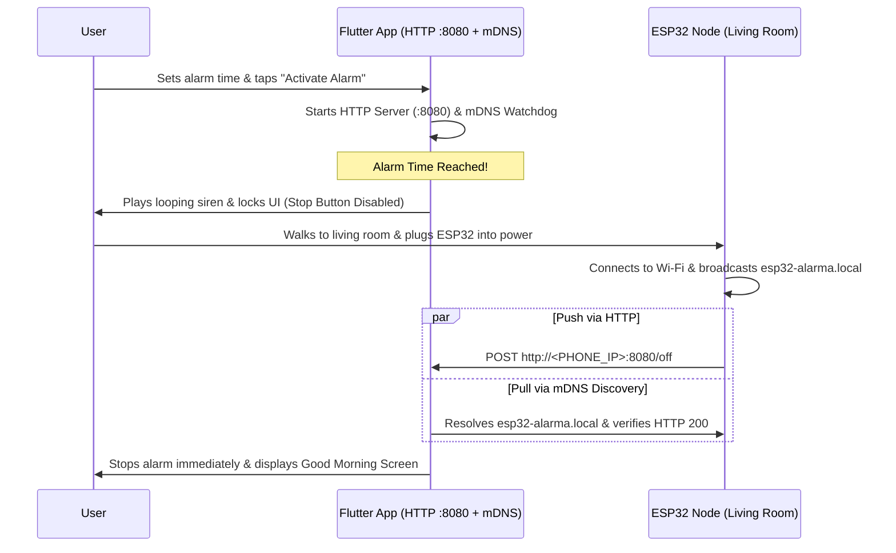

# ⚡ ANTI_ZOMBIE — IoT-Enforced Wake-Up Alarm (Flutter + ESP32)

> **A cross-platform mobile alarm app (iOS & Android) that physically forces you out of bed.**  
> The on-screen "Stop" button is disabled by design—the only way to silence the alarm is to walk to another room and plug in your **ESP32 microcontroller**, which authenticates over your local Wi-Fi network via **mDNS (`esp32-alarma.local`)** and an **embedded HTTP server (`shelf`)**.

---

## 🎯 Problem & Solution

Traditional mobile alarms fail because users unconsciously hit *Snooze* or *Dismiss* without leaving bed. **ANTI_ZOMBIE** solves this through **hardware-enforced physical movement**:

1. **Nighttime Setup:** Schedule your wake-up time using a zero-glare OLED dark-mode interface.
2. **Wake-Up Lockout ("The Golden Rule"):** When the alarm triggers, the app locks navigation (`PopScope`), plays a high-priority looping siren, and **disables manual dismissal**.
3. **Physical Verification via IoT:** You must walk to the living room and plug in your **ESP32**. Upon boot, the ESP32 connects to Wi-Fi, announces itself over **mDNS (`esp32-alarma.local`)**, and dispatches an HTTP `POST /off` request to the phone's local HTTP server (`port 8080`), immediately silencing the alarm and unlocking the *Good Morning* screen.

---

## ✨ Key Engineering Highlights

- **Embedded Local HTTP Server (`shelf` & `shelf_router`):** Runs an asynchronous HTTP server directly on the mobile device (`0.0.0.0:8080`) exposing `/off`, `/alarm/stop`, and `/status` REST endpoints.
- **Zero-Configuration Networking (`multicast_dns`):** Actively resolves `esp32-alarma.local` (`A`, `PTR`, and `SRV` records over `_http._tcp.local`) so the system works seamlessly even when router DHCP IP addresses change.
- **Fail-Safe In-Memory Audio Synthesis (`audioplayers`):** Configured with native high-priority alarm audio contexts (`AndroidUsageType.alarm` / `AVAudioSessionCategory.playback`). Includes a custom **16-bit PCM WAV dual-tone siren synthesizer** in memory as an automatic fallback if custom audio assets are missing.
- **Zero-Glare Circadian Dark UI:** Engineered exclusively for low-light environments using deep obsidian surfaces (`#070709`), warm amber accents (`#F59E0B`) for nighttime configuration, and pulsing crimson alerts (`#EF4444`) during active wake-up—completely avoiding pure white (`#FFFFFF`) eye strain.

---

## 🏗️ Project Architecture

```text
lib/
├── main.dart                              # App entry point & reactive phase router
├── core/
│   └── theme/
│       └── app_theme.dart                 # Zero-glare OLED Dark Mode design system
├── models/
│   └── alarm_state_model.dart             # Immutable models & AlarmPhase state machine
├── controllers/
│   └── alarm_controller.dart              # Central state orchestration (Audio + HTTP + mDNS)
├── services/
│   ├── alarm_audio_service.dart           # Looping alarm player + PCM WAV synthesizer
│   ├── local_http_server_service.dart     # Embedded Shelf HTTP server (Port 8080)
│   ├── mdns_discovery_service.dart        # mDNS resolver for esp32-alarma.local
│   └── notification_service.dart          # Full-screen high-priority local notifications
├── screens/
│   ├── alarm_setup_screen.dart            # Nighttime setup & network telemetry view
│   ├── alarm_ringing_screen.dart          # Locked wake-up alert screen (Stop disabled)
│   └── good_morning_screen.dart           # Post-wake summary & motivational dashboard
└── widgets/
    ├── dark_time_picker.dart              # Custom tactile 24h scroll wheel picker
    └── network_status_card.dart           # Real-time HTTP endpoint & mDNS status card
esp32_firmware/
└── alarma_antizombi_esp32.ino             # Companion C++/Arduino firmware for the ESP32
```

---

## 🔄 System Workflow



---

## 🚀 Getting Started

### 1. Mobile App (Flutter)
```bash
git clone https://github.com/AndresMaster/ANTI_ZOMBIE.git
cd ANTI_ZOMBIE
flutter pub get
flutter run
```

### 2. ESP32 Firmware
1. Open `esp32_firmware/alarma_antizombi_esp32.ino` in the Arduino IDE or PlatformIO.
2. Set your `WIFI_SSID`, `WIFI_PASSWORD`, and `PHONE_IP` (displayed on the app's **Local Network Telemetry** card).
3. Flash the firmware to your ESP32 and leave it unplugged in your living room overnight.

### 3. Quick Network Simulation (Without Hardware)
While the alarm is ringing on your phone, you can simulate the ESP32 wake-up signal from any computer on the same Wi-Fi network:
```bash
curl -X POST http://<YOUR_PHONE_IP>:8080/off \
  -H "Content-Type: application/json" \
  -d '{"hostname":"esp32-alarma.local"}'
```

---

## 🛠️ Tech Stack
- **Mobile Framework:** Flutter & Dart (`>=3.2.0 <4.0.0`)
- **State Management:** `provider` (`ChangeNotifier`)
- **Networking & IoT:** `shelf`, `shelf_router`, `multicast_dns`, `network_info_plus`, `http`
- **Audio & System Services:** `audioplayers`, `flutter_local_notifications`, `wakelock_plus`, `shared_preferences`
- **Hardware:** ESP32 (`WiFi.h`, `ESPmDNS.h`, `WebServer.h`, `HTTPClient.h`)
